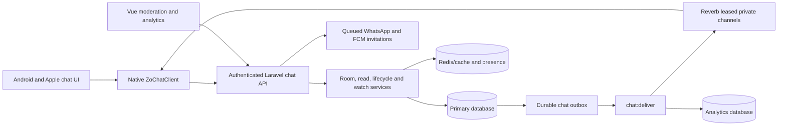

# Zo Stream chat: frontend/backend review after fixes

Reviewed on 27 October 2026 against the current working trees. This review
follows the earlier inspection and fixes; it examines the resulting code rather
than assuming that passing the earlier regression suite proves every flow.

## Result

Global chat, content chat, private invitations, watch together, unread/read
tracking and admin moderation are implemented across the Laravel API and mobile
clients. The primary integrations are present. Five remaining edge cases were
reproduced with temporary probes, and two additional frontend gaps were found
in source. This is not a production readiness sign-off.

Application source was not changed during this review. Probe sources/build
configuration were placed under `/private/tmp`; this document is the review
deliverable. Existing uncommitted application changes were preserved.

## Findings

### 1. A late history response can restore a transcript after access denial — P2

Android: `ZoStreamNew/app/src/main/java/com/buannel/studio/pvt/ltd/zostream/chat/ChatDialog.kt:777`
and `:816`. Apple: `Zo Stream/Pages/ChatView.swift:812` and `:902`.

Both access-denied handlers clear messages/cache, but leave the screen's
generation/history request epoch unchanged. Android history callbacks accept
results using `roomGeneration`/`historyEpoch`; Apple's async history merge uses
the view model's `generation`. The SDK's own revision change does not invalidate
these separate UI guards.

Reproduced on Android: hold a successful history response in flight, trigger
the SDK's room revocation, verify the transcript is cleared, then release the
response. Its message appears in the transcript again. This demonstrates a UI
state race, not a bypass of backend authorization: the held response was already
authorized before revocation. Apple has the equivalent source pattern but was
not exercised on a device.

Recommended correction: invalidate/cancel all history, pagination and send-result
merges on access denial, clear the active room state, and require a successful
new join before results may repopulate the transcript.

### 2. Missed deletions outside the recent page remain in cached history — P2

Android: `ChatDialog.kt:1550` and `:1600`. Apple: `ChatView.swift:878` and `:902`.

Connected reconciliation catches new messages and reloads the latest page.
`reconcileRecent` removes or replaces only cached IDs within that returned
window; older cached IDs are retained. A moderation deletion whose socket event
was missed is therefore never refreshed if its message lies before the newest
50-message production page. Retention expiry has a related stale-cache risk.

Reproduced with the Android test fixture's two-message page: load/cache messages
1–6, delete message 1 on the simulated server, and reconcile. The recent response
contains 5–6, and message 1's original text remains cached. The small fixture page
exposes the same boundary logic as the production 50-message page.

Also, normal `sync()` returns early while `hasNewer` is true, so recovery is
limited while the user is reading a paginated unread window.

Recommended correction: reconcile the loaded ID range or apply authoritative
deletion/retention information to the complete cached window while preserving
scroll position. Test older cached pages and unread windows, not only the newest
message page.

### 3. Closing a watch room still produces an active watch snapshot — P2

Backend: `app/Support/Chat/PrivateWatchService.php:83` and
`app/Console/Commands/DeliverChat.php:79`.

`snapshot()` reads `chat_invite_rooms.active` and stream liveness, but does not
check `chat_rooms.closed`. Admin close changes the latter and queues an `ended`
event. The worker attaches `snapshot()` to that event, so it can simultaneously
announce `kind: ended` and `watch.active: true` with usable-looking playback.

Reproduced: create a dedicated watch room, keep its host stream active, close it
through moderation, then inspect the worker's snapshot source. It returns active
playback while the join API correctly returns 403.

Recommended correction: include room closure in the authoritative watch snapshot
and stop active watch state when the room is closed/ended. Verify both dedicated
rooms and `/watch` sessions plus queued events around closure.

### 4. Muting a guest blocks a read-only dedicated watch-state fetch — P2

Backend: `app/Http/Controllers/Api/V4/ChatController.php:455`.

`updateInvitePosition()` calls `ChatService::room(..., true)` before determining
whether the request contains a position write. Guests use this endpoint with an
empty body to retrieve authoritative playback state, but `writing: true` also
applies mute restrictions. The `/watch` session endpoint uses the read access
path, so the two watch mechanisms differ.

Reproduced: mute an accepted dedicated-room guest. Joining/history return 200,
but an empty position request returns 403. This breaks guest baseline/reconnect
sync even though mute is otherwise treated as a send restriction.

Recommended correction: authorize reads separately and apply host/write checks
only when control data is actually supplied.

### 5. Stopped dedicated watch rooms remain in the restored room list — P2

Backend: `ChatController.php:243`, `InviteRoomLifecycle.php:11`, and
`ChatService.php:36`.

The lifecycle helper deliberately treats any active content-bound invite room
as an active candidate. `inviteRooms()` applies that lifecycle test without the
host-stream entitlement check used by `ChatService::room()`.

Reproduced: stop the host's stream. The watch room remains in `/invite-rooms`,
joining returns 403, and unread selection excludes it. Clients can retain a dead
tab; because the tab still exists in the restored list, the list-based fallback
to Global does not necessarily run. The earlier fix addressed live private rooms
after idle expiry, but this dedicated-room case still differs.

Recommended correction: make discovery consistent with current join eligibility
or return explicit unavailable state that both clients handle. Avoid conflating
private-room idle liveness with dedicated host-playback availability.

### 6. Push invitations have no dedicated frontend destination — P2, source finding

Backend: `ChatController.php:177`. Android:
`ZoStreamNew/.../App.java:50`. Apple: `Zo Stream/Zo_StreamApp.swift:131`.

The server sends `key: chat_invite`, `invite_id`, and `room_id` in FCM data.
The inspected Android launch handler and Apple notification response delegate
record notification analytics but do not consume these fields to open the
invitation or Invitations UI. No separate handler for these fields was found in
the inspected mobile sources. The URL-token invitation flow is implemented
separately and does not solve routing for this push payload.

Expected user impact: a delivered push can open the app without taking the user
to its invitation. This is a navigation gap; actual FCM delivery and notification
tap behavior were not tested on devices.

Recommended correction: route the authenticated invitation ID after launch/login
on both platforms, with account verification through the existing API. Cover
cold start, already-running app, logout and a different signed-in account.

### 7. Admin history labels offset timestamps as UTC — P3, source finding

Frontend: `resources/js/admin/pages/ChatPage.vue:25`.

`stamp()` modifies the timestamp string and appends `UTC` without parsing or
converting it. Chat message serialization uses an explicit application-timezone
offset (`Asia/Kolkata` in the checked config), so an ISO value such as
`2026-10-27T10:00:00+05:30` becomes `2026-10-27 10:00:00+05:30 UTC`.
That label is contradictory and can mislead an operator comparing audit events.

Recommended correction: parse timestamps and format in one declared timezone,
or preserve their original offset without adding a UTC label. Test unzoned DB
timestamps separately from offset-bearing message timestamps.

## Structure and boundaries

| Area | Implementation | Responsibilities |
| --- | --- | --- |
| Authentication | `AuthTokenMiddleware`, `AdminTokenMiddleware` | Trusted account/device identity and staff access |
| API routing/throttle | `routes/api_v4.php`, `ChatThrottle` | Viewer/admin endpoints, feature flag, per-action account throttles |
| Core chat | `ChatController`, `ChatService` | Room access, send/history, blocks, reports, moderation and caching |
| Room lifetime | `InviteRoomLifecycle` | Idle/live-private-room candidate checks and exact token-bound liveness |
| Unread/read | `ChatReadService`, native unread stores | Allowed rooms, unread deltas, visible-row read cursor and account sync |
| Playback sharing | `PrivateWatchService`, `WatchPlaybackState` | Watch cards, host/stream binding, guest participation and control revisions |
| Realtime | `ChatChannels`, `DeliverChat`, both SDKs | Signed physical channel leases, publication, renewal, reconnect and callbacks |
| Invitations | Link controller, WhatsApp job, native invitation UI | Per-recipient hashed links, response states, content routing |
| Admin | `AdminChatController`, `ChatPage.vue`, `ChatAnalyticsPanel.vue` | Review, restrictions, audit and aggregate metrics |
| Cleanup | `PruneChat`, daily scheduler | History, reports, watch-message dependents, delivered outbox and expired bans |

There are no dedicated chat Eloquent models: services use Laravel's query builder.
Current high-coupling files include `ChatController.php` (~687 lines), Android
`ChatDialog.kt` (~1,886) and Apple `ChatView.swift` (~2,777). The native SDKs
separate transport, but UI files still combine room, transcript, invitation,
read-state and watch-session logic. Their separate generation/cancellation
boundaries explain some of the remaining race conditions.

Consumer chat is implemented in the inspected Android and Apple mobile apps.
No equivalent integration was found in the scanned TV SDK/TV source paths.
The browser implementation provides admin tools and a public invitation landing
page; it is not a general consumer web-chat screen.

## Functional flow

1. **Entry:** Home opens Global. An online movie/episode player can show embedded
   chat, with video above chat in portrait and beside it in landscape. Offline
   playback does not grant content chat. Room tabs restore private memberships.
2. **Join:** middleware supplies account/device identity. Public content rooms
   require an owned, matching active playback token; private rooms require host
   or accepted-member access. Server returns logical room/channel metadata.
3. **Subscribe:** native SDK obtains a socket ID and asks the API to sign a
   physical channel. It subscribes to the auth response's `.lease.<epoch>` name,
   renews at expiry and rejects frames from other channels.
4. **History/send:** history pages contain 50 ordered messages with exclusive
   before/after cursors. Sending validates text/spoiler/session data and a UUID.
   The database transaction stores message plus outbox, with a unique
   `(user_id, request_id)` key for retry idempotence and a shared slow-mode key.
5. **Delivery/recovery:** `chat:deliver` emits change notifications and independent
   analytics retries. Message bodies are retrieved through authorized HTTP.
   Connected transcripts reconcile every 30 seconds; disconnected recovery is
   roughly one minute. Findings 1–2 describe the remaining limits of this recovery.
6. **Read/unread:** a separate observer socket handles badge channels without room
   presence. Counts exclude own/blocked/deleted/expired messages. Visible rows
   advance shared monotonic read cursors; local account-specific pending reads
   retry after failure. Integrity snapshots remain separate from transcript sync.
7. **Invite:** creator names a room and resolves invitees by phone. Each request
   accepts 1–20 invitees. Pending invites expire after 24 hours; accepted members
   can restore room access subject to lifecycle/authorization. Link tokens are
   per-recipient, hashed at rest and checked against the signed-in account.
8. **Watch:** dedicated content invite rooms and private-room `/watch` cards are
   distinct paths. Only the creator's active player sends controls. PPV sharing
   is rejected and premium participation checks subscription state. Sequenced
   position/pause/seek state travels over the socket; minute heartbeats keep
   stream/participant state fresh. Joined and streaming invitee counts differ.
9. **Moderation:** spoiler reveal, long-press report/block and unblock UI exist.
   Admin review works independently of viewer playback and offers delete,
   mute/ban/unban, close/open, report resolution and reasoned audit records.
10. **Exit/deletion:** clients release connections on background/logout/disposal;
    hiding player chat can retain watch control. Account deletion now tombstones
    messages and cleans hosted rooms, watch identities, invitations and caches.

## Storage, security and operational limits

Tables cover rooms, messages, bans, blocks, reports, moderation actions, invite
rooms/memberships, read cursors, watch sessions/participants and the durable
outbox. The message schema indexes room/message order, creation time and
idempotency; other tables carry membership/read lookup keys. Cross-table
integrity depends substantially on service transactions and explicit cleanup.

Redis caches recent messages, room metadata, restrictions and playback checks;
it also supports presence and shared send throttling. Read failures generally
fall back to DB. Mutation throttle failures fail closed. These are intended
availability tradeoffs; Redis/DB outage behavior was not load-tested here.

Channel leases last at most five minutes with a one-minute publication grace.
Metadata revocation is consequently bounded to six minutes, not immediate socket
eviction. HTTP body access is checked separately. The API/worker and both updated
SDK/app builds require a coordinated release; older permanent-channel clients
cannot receive the leased stream.

History retention is 30 days; pending reported messages may remain for 90 days.
Room/invitation metadata and undelivered outbox growth still need operational
monitoring and a retention policy. Room lists are unpaginated and unread work
grows with eligible rooms. Message events also cause viewer HTTP fetches even
when DB caching helps. No concurrency or capacity claim follows from unit tests.

## Verification

- Re-ran existing backend chat/queue/WhatsApp/V4 regressions: **95 tests,
  1,266 assertions, no failures**; existing PHP 8.5 deprecations remain.
- Temporary backend probes: **3 tests, 19 assertions**, confirming findings 3–5.
  These assert the observed problematic behavior, not corrected behavior.
- Temporary Android probes: **2 tests**, confirming findings 1–2 against the
  actual dialog/SDK and fixture HTTP client. Added test sources through a
  temporary Gradle init script; application source was not edited.
- Existing Android chat SDK/UI regression run succeeds: **34 chat tests** across
  ChatRoomSwitchTest, ChatListPositionerTest, ChatHistoryTest and
  ChatUnreadTrackerTest. The probe findings are outside their existing assertions.
- Vue admin production build succeeds with temporary output. Swift SDK build,
  Apple chat-screen syntax parsing and **5 standalone Swift chat checks** pass.
  The standalone runner is not a full XCTest/iOS app test run.
- The probes use test fixtures and controlled delayed responses. They do not
  establish exploitability beyond the stated authorization/UI sequence.
- Apple equivalents, push tap handling and admin timestamp behavior were
  assessed in source. Full iOS app/device rendering, real FCM/WhatsApp delivery,
  live Reverb/Redis/MySQL interleavings and deployment configuration remain
  outside this local inspection.

The previous fixes remain useful and their existing tests pass. The findings
above are additional coverage gaps that need their own corrections and
regressions before treating all chat flows as verified.
